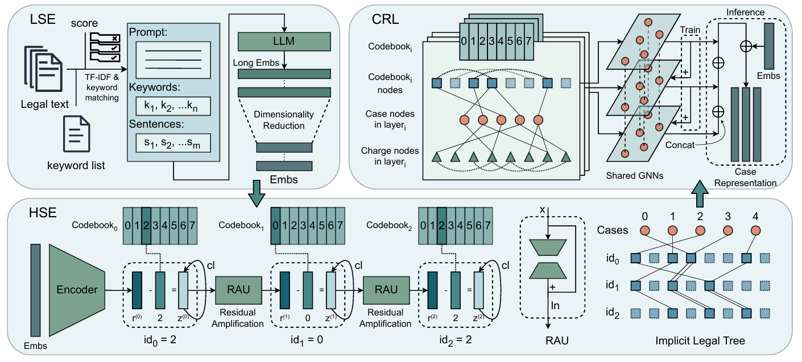

# ⚖️ DSLaw

### Implicit Hierarchical Modeling for Cross-System Legal Case Retrieval

🎉 **Our paper has been accepted to Findings of EMNLP!**

Welcome to the DSLaw repository! DSLaw learns hierarchical legal semantics through residual quantization and uses discrete semantic IDs to connect related cases for graph-based retrieval.

Want to try it out? Follow the workflow below: **prepare data → train HSE → export representations → train CRL → evaluate**. 🚀

## 🧭 At a Glance



- ✂️ **LSE — Legal Summary Extraction:** turn long legal documents into compact summary embeddings.
- 🧩 **HSE — Hierarchical Semantics Encoding:** learn multi-level semantic IDs with residual quantization and the Residual Amplification Unit (RAU).
- 🕸️ **CRL — Case Representation Learning:** connect cases through semantic IDs and learn graph-enhanced retrieval representations.

## 🛠️ Environment Setup

Use **Python 3.10** and a PyTorch build compatible with your CUDA environment. A GPU is recommended for training.

```bash
uv venv --python 3.10
source .venv/bin/activate
uv pip install torch torch-geometric numpy scikit-learn \
  k-means-constrained tqdm pytz transformers nltk jieba rank-bm25 \
  jupyterlab ipykernel
```

For English preprocessing, download the NLTK tokenizer resources:

```bash
uv run --active -- python -m nltk.downloader punkt punkt_tab
```

## 📦 What Data Do I Need?

The main experiments use **COLIEE2025** and **ELAM**. Additional LeCaRDv2 resources are also included. See [dataset instructions](dataset/README.md) for availability and licensing.

You can start directly from prepared embeddings! For each dataset, provide:

| Input | What it contains |
|---|---|
| Case embeddings | `<D>_white_emb.npy`: all case embeddings, shape `[N, d]` |
| Category embeddings | `<D>_charge_white_emb.npy`: category embeddings, shape `[C, d]` |
| Case ID mapping | `<D>_all_ids.json`: original case IDs → integer row IDs |
| Split IDs and embeddings | Ordered case ID lists and corresponding `.npy` arrays for training and validation |
| Positive relations | `*_relative.json`: case ID → relevant case IDs |
| Hard negatives | `*_hard_neg.json`: case ID → negative case IDs |
| Category mappings | `<D>_charge_id.json` and `<D>_charge_case.json` |
| Evaluation labels | `*_gt.trec`: relevance judgments in TREC format |

Here, `<D>` is `ELAM` or `COLIEE`. For split files, examples include `train_candidate_ids.json`, `train_candidate_emb.npy`, and their evaluation counterparts. HSE validation also takes an anchor ID list such as `test_ids.json`.

💡 **Keep IDs aligned:** each integer case ID indexes its global embedding row; split embeddings must follow their paired ID list exactly. Category embedding rows must follow category IDs. Encode cases and categories with the same fitted PCA-whitening transformation.

Relation dictionaries use string keys and integer ID lists, for example: `{"0": [12, 31], "1": [7]}`. Remove known positives and the anchor itself from negative pools, and provide enough negatives for the configured sampling count. Use an independent development split for checkpoint selection.

## 🚀 Quick Start

The examples use **ELAM**. For COLIEE2025, use the corresponding `COLIEE` scripts and files. Set the input/output locations in the scripts before running.

### 1️⃣ Prepare the Data

In `code/dataset_process/<D>/`, run **`process_1.py` → `process_2.py` → `process_3.py`**, followed by **`process_train.py` and `process_test.py`**.

For example, run the first ELAM preprocessing step with:

```bash
cd code/dataset_process/ELAM
uv run --active process_1.py
```

Run the remaining scripts in the same directory using the same command pattern. The numbered steps prepare text records, select key text, and build similarity-based candidate lists; the train/test scripts prepare split relations and embedding arrays.

If starting from raw text, prepare the summaries and their encoded, PCA-whitened case/category embeddings before extracting split arrays. If you already have the prepared inputs above, skip straight to HSE training. ⏩

### 2️⃣ Train HSE

Use the dataset-specific configuration in `code/rqvae/<D>/run.sh`. From the repository root:

```bash
(cd code/rqvae/ELAM && bash run.sh 0)
```

`0` selects the GPU. Training produces HSE checkpoints and logs. Adjust dataset paths and experiment settings in `run.sh` as needed.

### 3️⃣ Export Representations

Open **`code/rqvae/eval/<D>_gen.ipynb`** in Jupyter and run the cells in order. Set the checkpoint, case embedding, category embedding, device, and output locations in the notebook first. Use your project environment as the notebook kernel; add the repository's `code/` directory to the module search path if required.

The notebook exports four arrays for CRL:

- 🔢 `<D>_data_ids.npy` — case semantic IDs, `[N, L]`.
- 📄 `<D>_data_quant.npy` — layer-wise case representations, `[N, L, d]`.
- 🏷️ `<D>_charge_quant.npy` — layer-wise category representations, `[C, L, d]`.
- 🧩 `<D>_codebook.npy` — codebook vectors, `[L, K, d]`.

Keep their row order consistent with your case/category IDs, and match the exported layer counts and dimensions in the CRL configuration.

### 4️⃣ Train CRL

Use **`code/graph/train/<D>/run.sh`**. For ELAM, run from the repository root:

```bash
(cd code/graph/train/ELAM && bash run.sh 0)
```

Point the configuration to the HSE exports, original case embeddings, category mappings, and split relations. Training prints the checkpoint save location. Use the selected model to obtain case representations and rank candidates by cosine similarity.

### 5️⃣ Evaluate Retrieval

Save rankings in TREC run format: `query_id Q0 candidate_id rank score run_name`. For example: `0 Q0 12 1 0.923 DSLaw`. Keep the ID convention consistent with your relevance file and exclude the query itself from candidates.

From the repository root:

```bash
uv run --active code/EvaluateCode/trecEval_auto.py \
  --result_file output/ELAM_result.trec \
  --relevance_file dataset/ELAM/test/test_gt.trec \
  --output_dir output/evaluation/ELAM \
  --model_name DSLaw --dataset_name ELAM
```

The evaluator reads your rankings and saves the retrieval metrics. 📊

## 🗂️ Where to Find Things

| Directory | Purpose |
|---|---|
| `code/dataset_process/` | Text preprocessing and data preparation |
| `code/rqvae/` | HSE training and representation export; historical directory name retained |
| `code/graph/` | CRL graph construction and training |
| `code/EvaluateCode/` | TREC ranking evaluation |
| `dataset/` | Dataset resources, split files, and relevance labels |
| `example/` | Worked example and retrieval error analysis |
| `figure/` | Framework illustrations |

## 📚 More Details

[Datasets](dataset/README.md) · [Preprocessing](code/dataset_process/README.md) · [HSE](code/rqvae/README.md) · [CRL](code/graph/README.md) · [Evaluation](code/EvaluateCode/README.MD)

For a closer look at the retrieval workflow, check out the [end-to-end example](example/end_to_end%20example.md) and [error analysis](example/error_analysis.md).
